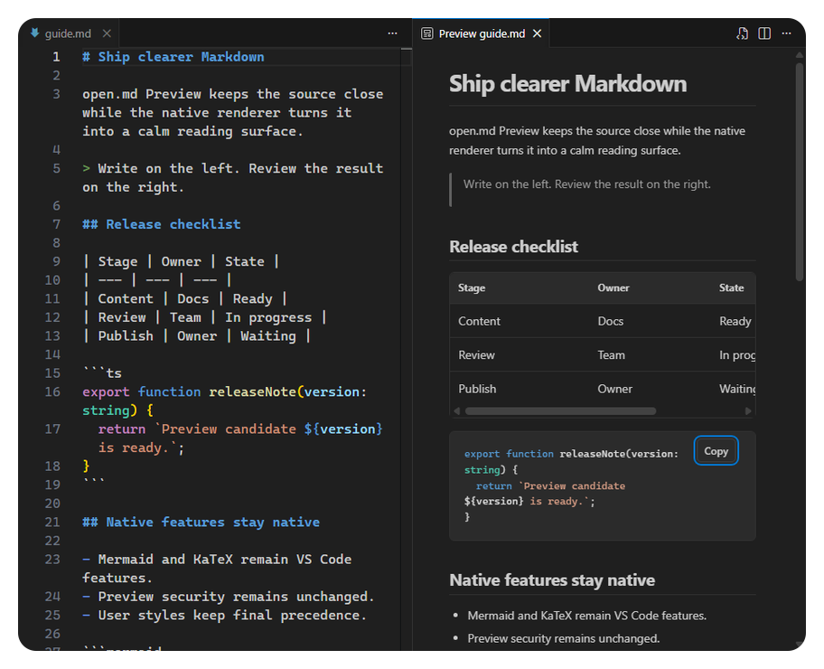

  

# open.md Preview

**A calm native Markdown preview that opens beside your editor and follows what you write.**

open.md Preview keeps VS Code's built-in Markdown renderer. Mermaid diagrams, KaTeX math, links, images, preview security, and your existing `markdown.styles` continue to work as VS Code intends.

## What it does

- Opens the native preview to the right when you open a saved Markdown file.
- Keeps keyboard focus in the source editor.
- Reuses VS Code's unlocked preview as you move between Markdown files.
- Leaves locked previews, tab placement, and manually opened previews alone.
- Adds a focused 840 px reading column, clearer tables and code, reading progress, code copy, and back to top.
- Works in desktop, web, remote, virtual, and restricted workspaces.

Close an automatically opened preview and it stays closed for that file during the current window session. Re-enable automatic preview to clear that suppression for the active file.

## Setting and command

| Surface | Purpose |
| --- | --- |
| `openMdPreview.autoOpen` | Controls future automatic openings. Default: `true`. |
| **open.md Preview: Toggle Auto Preview** | Toggles the most specific setting for the active file. |

The toggle uses a folder setting in a multi-root workspace, a workspace setting in a single workspace, and a global setting outside a workspace unless a more specific override already exists.

## Intentional exclusions

Automatic preview does not run for untitled editors, diffs, notebooks, MDX, or recognized prompt, instruction, agent, and skill files. The reading styles and controls still apply whenever you open a native Markdown preview manually.

## Privacy and security

The extension has no telemetry, network client, workspace scan, file reader, or document-content log. VS Code remains responsible for Markdown preview security. See [SECURITY.md](SECURITY.md).

## Development

Requires VS Code 1.134 or newer and pnpm 12. See [docs/development.md](docs/development.md) for the local verification matrix.

## License

MIT. Selected reading geometry and accessible interaction patterns were adapted from `open.md` at commit `253311e2cd4dc2a612e5ebac8c35358f877214dc`; see [THIRD_PARTY_NOTICES.md](THIRD_PARTY_NOTICES.md).
