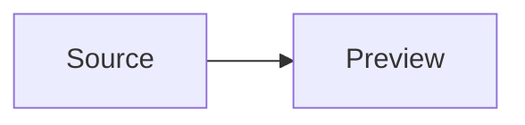

# Atlas release guide

This document verifies automatic preview and the open.md reading layer.

## Prepare the candidate

1. Build the extension.
2. Package the VSIX.
3. Install the package in a clean profile.

> The native Markdown renderer remains responsible for links and local resources.

```ts
const candidate = {
  version: "0.1.0",
  state: "ready",
};
```

| Gate | Result |
| --- | --- |
| Types | Pass |
| Unit tests | Pass |
| Package | Pending |

## Architecture



Inline mathematics stays native: $a^2 + b^2 = c^2$.

## Reading notes

The source remains focused while this preview follows the active document. The controls belong to the preview contribution, not a custom renderer.

### Privacy

The extension does not send content across the network. It does not scan the workspace or record document text.

### Compatibility

The Node and browser bundles use the same controller. The extension supports local, remote, virtual, and restricted workspaces.

### Completion

This final section makes the fixture long enough to exercise reading progress and back-to-top behavior in a normal editor group.
